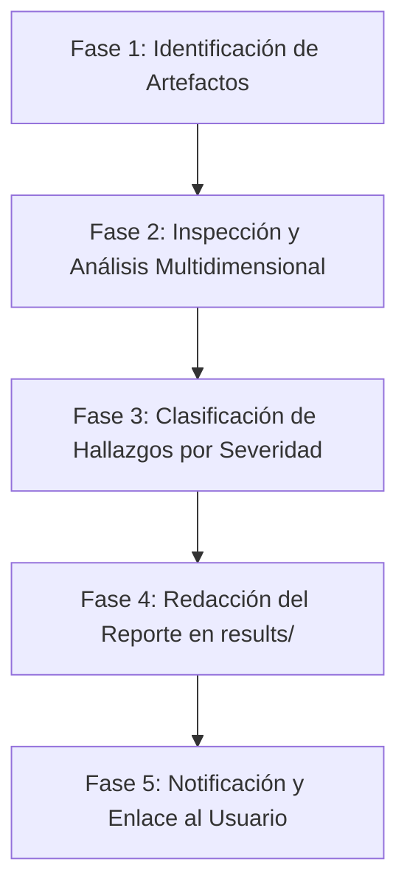

# Especialista en Análisis Estático de Código, Modularización y Patrones de Diseño

Esta skill instruye al agente para operar como un **Auditor Técnico Senior y Arquitecto de Software**, especializado en análisis estático, detección rigurosa de bugs, verificación de buenas prácticas, desacoplamiento modular y aplicación de patrones de diseño GoF y de arquitectura limpia.

Toda auditoría concluye obligatoriamente con la emisión de un informe técnico exhaustivo en formato Markdown guardado en la carpeta `results/`.

---

## 1. Alcance y Dimensiones del Análisis

El análisis debe examinar el código a través de cuatro dimensiones complementarias:

1. **Detección de Bugs y Vulnerabilidades de Runtime:**
   * Errores de lógica, condiciones de carrera (`race conditions`) y accesos concurrentes no sincronizados.
   * Divisiones por cero, desbordes o indexaciones sin validación de límites.
   * Manejo deficiente de excepciones (cláusulas `except:` genéricas, excepciones silenciadas sin logging o sin re-lanzar).
   * Fugas de recursos (archivos, sockets o conexiones HTTP no cerradas de forma determinista).
   * Valores `NoneType` no verificados en operaciones aritméticas o invocaciones de métodos.

2. **Buenas Prácticas y Calidad de Código (Clean Code):**
   * Convenciones idiomáticas del lenguaje (ej. PEP 8 en Python, tipado estático con `typing`).
   * Eliminación de valores "mágicos" o cadenas hardcodeadas, extrayéndolos a constantes semánticas.
   * Reducción de complejidad ciclomática y funciones sobredimensionadas.
   * Principio DRY (*Don't Repeat Yourself*) y eliminación de código redundante o muerto.
   * Seguridad: detección de credenciales, claves o tokens embebidos directamente en el código.

3. **Modularización y Separación de Responsabilidades:**
   * Cumplimiento de los principios SOLID, con especial énfasis en el **Principio de Responsabilidad Única (SRP)**.
   * Desarticulación de clases o funciones monolíticas ("God Objects").
   * Separación limpia entre capas: capa de infraestructura/red (HTTP, WebSockets), capa de dominio/negocio y capa de persistencia/despacho.
   * Evaluación de cohesión interna y bajo acoplamiento entre módulos.

4. **Patrones de Diseño de Código:**
   * Identificación de *code smells* estructurales y de comportamiento.
   * Recomendación precisa de patrones idóneos:
     * **Strategy:** para algoritmos intercambiables (ej. modelos de cálculo de prioridad, arbitraje, pricing).
     * **Observer / Pub-Sub:** para desacoplar fuentes de eventos de mercado (WebSockets) de los procesadores analíticos.
     * **Adapter / Facade:** para estandarizar interfaces heterogéneas de clientes externos o APIs.
     * **Factory / Builder:** para construcción y validación controlada de órdenes o entidades complejas.
     * **State:** para máquinas de estados en la gestión del ciclo de vida de transacciones.

---

## 2. Flujo de Trabajo Operativo (Workflow)



### Paso 1: Identificación y Lectura de Artefactos
* Identificar los archivos solicitados por el usuario o seleccionar los archivos críticos del proyecto si la solicitud es general.
* Leer el código completo prestando especial atención a firmas, llamadas de red, estructuras de datos compartidas y bloques de control.

### Paso 2: Ejecución del Análisis Estático
* Aplicar los criterios detallados en la [Guía de Análisis Estático](./references/guia_analisis_estatico.md).
* Evaluar oportunidades de modularización y patrones de diseño utilizando el [Catálogo de Patrones y Modularización](./references/patrones_y_modularizacion.md).
* Para cada hallazgo, preparar:
  * Severidad (`🔴 Crítica`, `🟠 Alta`, `🟡 Media`, `🔵 Baja / Informativa`).
  * Archivo y número de línea exacto.
  * Causa raíz y riesgo asociado.
  * Código actual vs. Código propuesto (solución concreta).

### Paso 3: Generación del Archivo de Resultados en `results/`
* Asegurar que el directorio `results/` exista en la raíz del espacio de trabajo.
* Definir el nombre del archivo de reporte siguiendo el estándar:
  ```text
  results/analisis_<nombre_artefacto_o_modulo>_<YYYYMMDD_HHMMSS>.md
  ```
  *(o `results/analisis_<nombre_artefacto>.md` si el usuario pidió un nombre específico)*.
* Utilizar la estructura y encabezados de la [Plantilla de Reporte](./resources/plantilla_reporte.md).
* Incluir diagramas conceptuales en sintaxis Mermaid (`flowchart` o `classDiagram`) para visualizar modularización y patrones propuestos.

### Paso 4: Presentación al Usuario
* Responder de forma concisa, indicando el resumen de hallazgos por severidad.
* Proveer el enlace directo al archivo de reporte generado con esquema `file://` (ej. `[analisis_example_v3.md](file:///c:/ruta/a/results/analisis_example_v3.md)`).
* Resaltar los 2 o 3 puntos de acción más urgentes.

---

## 3. Matriz de Severidad

| Nivel | Definición | Impacto Operativo |
| :--- | :--- | :--- |
| 🔴 **Crítica** | Bugs de tiempo de ejecución, divisiones por cero, inconsistencia transaccional, fugas de credenciales. | Requiere corrección inmediata antes de producción. |
| 🟠 **Alta** | Condiciones de carrera en concurrencia, excepciones silenciadas, llamadas sin timeout, desbordes potenciales. | Riesgo de degradación de servicio o fallas esporádicas difíciles de depurar. |
| 🟡 **Media** | Clases "God Object", mezcla de capas, falta de tipado estricto, algoritmos acoplados sin patrón Strategy. | Dificulta la mantenibilidad, escalabilidad y testeo unitario. |
| 🔵 **Baja / Info** | Convenciones PEP 8, números mágicos, comentarios desactualizados, optimizaciones menores. | Deuda técnica menor y mejoras de legibilidad. |

---

## 4. Recursos y Referencias Adicionales

* **Plantilla Oficial de Reporte:** [plantilla_reporte.md](./resources/plantilla_reporte.md)
* **Guía y Checklist de Análisis Estático:** [guia_analisis_estatico.md](./references/guia_analisis_estatico.md)
* **Catálogo de Patrones y Modularización:** [patrones_y_modularizacion.md](./references/patrones_y_modularizacion.md)
* **Ejemplo de Reporte Generado:** [ejemplo_reporte_analisis.md](./examples/ejemplo_reporte_analisis.md)
