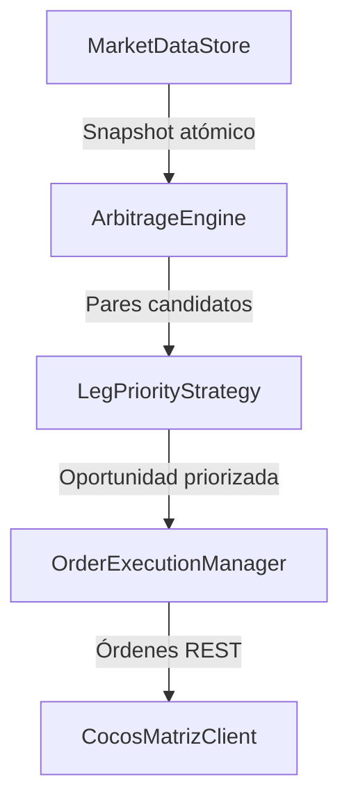

# Reporte de Análisis Estático, Buenas Prácticas y Arquitectura: Módulo Arbitraje

**Fecha de Evaluación:** `2026-11-17 15:30:00`  
**Artefactos Analizados:** `example_v3.py`  
**Responsable / Rol:** Especialista en Análisis Estático de Código y Arquitectura  
**Estado General:** Aprobado con observaciones (Requiere refactorizaciones de modularización y desacoplamiento)

---

## 1. Resumen Ejecutivo

Se realizó un análisis estático exhaustivo del archivo `example_v3.py`, responsable de la recepción de cotizaciones en tiempo real por WebSocket, cálculo de tipos de cambio implícitos, detección de arbitrajes cruzados multidireccionales y enrutamiento prioritario de órdenes hacia la API de Cocos/Matriz.

El motor algorítmico es funcionalmente robusto en sus validaciones de volumen y desvíos vs AL30; sin embargo, presenta alta deuda técnica en acoplamiento (`God Class`), manejo genérico de excepciones y mezcla de responsabilidades de transporte con lógica matemática pura de arbitraje.

### Métricas Generales y Distribución de Hallazgos

| Nivel de Severidad | Cantidad | Descripción General |
| :--- | :---: | :--- |
| 🔴 **Crítica** | 1 | Potencial `ZeroDivisionError` en cálculo de ratios con precios en cero o `None`. |
| 🟠 **Alta** | 2 | Cláusulas `except Exception:` genéricas sin backoff y riesgo de concurrencia en `instrumentos`. |
| 🟡 **Media** | 3 | Violación de SRP en la clase `Executer`, ausencia de `dataclasses` para cotizaciones. |
| 🔵 **Baja / Informativa** | 2 | Números mágicos en tolerancias y variables no tipadas. |
| **Total de Hallazgos** | **8** | |

---

## 2. Matriz de Hallazgos Detectados

| ID | Severidad | Categoría | Archivo y Línea(s) | Resumen del Problema |
| :--- | :--- | :--- | :--- | :--- |
| **BUG-01** | 🔴 Crítica | Lógica / Runtime | `example_v3.py#L292-L299` | Falta de control estricto de valores `<= 0` antes de la división en ratios. |
| **CONC-01**| 🟠 Alta | Concurrencia | `example_v3.py#L240-L262` | Modificación de diccionario de cotizaciones desde el hilo WebSocket sin `threading.Lock`. |
| **EXC-01** | 🟠 Alta | Resiliencia | `example_v3.py#L82-L84` | Captura genérica de excepciones en login sin reintentos ni tipado del error. |
| **MOD-01** | 🟡 Media | Modularización | `example_v3.py#L264-L715` | `Executer` asume análisis de oportunidades, selección de prioridades y despacho de órdenes. |
| **PAT-01** | 🟡 Media | Patrones de Diseño | `example_v3.py#L344-L417` | Lógica de priorización de patas acoplada directamente en lugar de usar `Strategy`. |
| **DAT-01** | 🟡 Media | Tipado y Datos | `example_v3.py#L420-L540` | Uso de diccionarios no estructurados (`Dict[str, Any]`) en lugar de `dataclass` tipada. |
| **STY-01** | 🔵 Baja | Clean Code | `example_v3.py#L379` | Constante `TOLERANCE` declarada dentro de un método en lugar de a nivel de módulo. |
| **DOC-01** | 🔵 Baja | Documentación | `example_v3.py#L601` | Docstrings desactualizados que aún refieren a desviación estadística en lugar de AL30. |

---

## 3. Detalle Técnico de Hallazgos y Propuestas de Cambio

### [BUG-01] Blindaje ante división por cero en cálculo de ratios
* **Severidad:** `🔴 Crítica`
* **Categoría:** Lógica / Runtime
* **Ubicación:** `[example_v3.py](file:///c:/Users/magin/OneDrive/Documentos/python-projects/dolarMEP/example_v3.py#L290-L300)`
* **Descripción:** Si una punta llega con cotización 0.0 o corrupta desde el WebSocket, el cálculo genera una excepción no controlada que aborta el ciclo de evaluación.

#### Código Actual
```python
item["USD_a_pesos"] = (
    float(pr_compra_pesos / pr_venta_dolar)
    if pr_compra_pesos and pr_venta_dolar and pr_compra_pesos > 0 and pr_venta_dolar > 0
    else None
)
```

#### Código Propuesto
```python
MIN_PRICE_THRESHOLD = 0.0001

if (
    pr_compra_pesos is not None and pr_compra_pesos > MIN_PRICE_THRESHOLD
    and pr_venta_dolar is not None and pr_venta_dolar > MIN_PRICE_THRESHOLD
):
    item["USD_a_pesos"] = float(pr_compra_pesos / pr_venta_dolar)
else:
    item["USD_a_pesos"] = None
```
* **Beneficio:** Garantiza estabilidad ante anomalías transitorias en las puntas del libro de órdenes.

---

### [CONC-01] Protección de acceso concurrente a la estructura de cotizaciones
* **Severidad:** `🟠 Alta`
* **Categoría:** Concurrencia
* **Ubicación:** `[example_v3.py](file:///c:/Users/magin/OneDrive/Documentos/python-projects/dolarMEP/example_v3.py#L240-L262)`
* **Descripción:** Las cotizaciones se actualizan en el callback asíncrono de WebSocket mientras el hilo principal itera sobre la lista en `execute()`, pudiendo generar lecturas inconsistentes (Dirty Reads) o `RuntimeError: dictionary changed size during iteration`.

#### Código Propuesto
```python
import threading

class MarketDataStore:
    def __init__(self):
        self._lock = threading.RLock()
        self._quotes: Dict[str, MarketQuote] = {}

    def update_quote(self, ticker: str, bid: float, ask: float, bid_size: int, ask_size: int):
        with self._lock:
            # Actualización atómica
            ...

    def get_snapshot(self) -> List[MarketQuote]:
        with self._lock:
            return copy.deepcopy(list(self._quotes.values()))
```

---

## 4. Evaluación de Modularización y Arquitectura

### 4.1. Diagnóstico de la clase `Executer`
Actualmente, `Executer` realiza 4 tareas completamente independientes:
1. Almacenamiento y caching de oportunidades previas (`tracked_opportunities`).
2. Evaluación matemática combinatoria de pares de arbitraje.
3. Decisión de prioridad de pata (lógica analítica vs AL30).
4. Ejecución y despacho secuencial de órdenes REST/LIMIT.

### 4.2. Propuesta de Descomposición Modular


---

## 5. Patrón de Diseño Recomendado: `Strategy` para Priorización

Encapsular la selección de prioridad de patas mediante una interfaz abstracta:

```python
from abc import ABC, abstractmethod

class PriorityStrategy(ABC):
    @abstractmethod
    def select_priority(self, inst_A: MarketQuote, inst_B: MarketQuote, context: Dict) -> PriorityResult:
        pass

class AL30ConsensusPriorityStrategy(PriorityStrategy):
    def select_priority(self, inst_A: MarketQuote, inst_B: MarketQuote, context: Dict) -> PriorityResult:
        # Implementación de ventaja relativa contra AL30
        ...

class LiquidityPriorityStrategy(PriorityStrategy):
    def select_priority(self, inst_A: MarketQuote, inst_B: MarketQuote, context: Dict) -> PriorityResult:
        # Prioriza la pata con menor volumen en el libro
        ...
```

---

## 6. Plan de Acción y Priorización

1. **Inmediato:** Implementar `MarketDataStore` con `RLock` y blindar divisiones con `MIN_PRICE_THRESHOLD`.
2. **Mediano Plazo:** Extraer `ArbitrageEngine` y `OrderExecutionManager` de `Executer`.
3. **Largo Plazo:** Migrar diccionarios sueltos a `dataclasses` inmutables y desacoplar estrategias de priorización.
