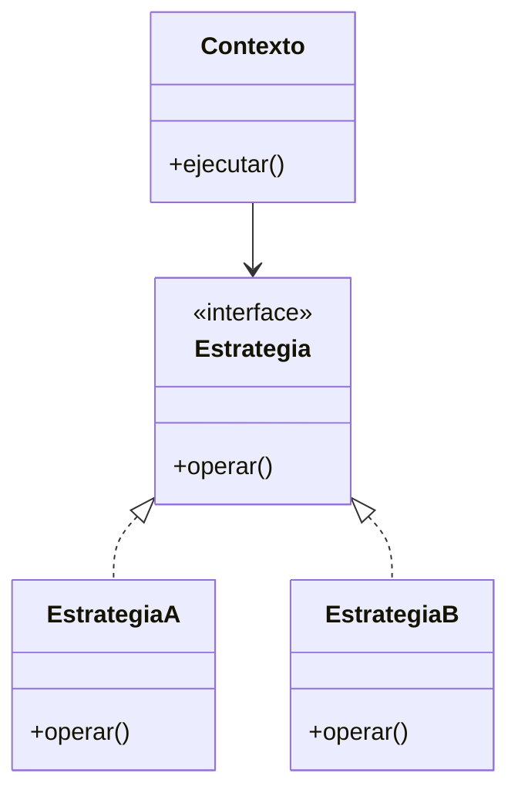

# Reporte de Análisis Estático, Buenas Prácticas y Arquitectura

**Fecha de Evaluación:** `{{FECHA_EVALUACION}}`  
**Artefactos Analizados:** `{{LISTA_ARTEFACTOS}}`  
**Responsable / Rol:** Especialista en Análisis Estático de Código y Arquitectura  
**Estado General:** `{{ESTADO_GENERAL}}` *(Aprobado con observaciones / Requiere refactorización crítica / Conforme)*

---

## 1. Resumen Ejecutivo

*Breve diagnóstico del estado actual del código analizado, destacando los puntos fuertes, las vulnerabilidades o bugs más sensibles encontrados y el impacto potencial en estabilidad, mantenimiento y rendimiento.*

### Métricas Generales y Distribución de Hallazgos

| Nivel de Severidad | Cantidad | Descripción General |
| :--- | :---: | :--- |
| 🔴 **Crítica** | `{{CANT_CRITICA}}` | Bugs que causan fallas en tiempo de ejecución, corrupción de datos o brechas de seguridad. |
| 🟠 **Alta** | `{{CANT_ALTA}}` | Vulnerabilidades lógicas, manejo defectuoso de excepciones o riesgo de deadlock/concurrencia. |
| 🟡 **Media** | `{{CANT_MEDIA}}` | Violaciones de principios de modularización (SRP), código acoplado, falta de tipado estricto. |
| 🔵 **Baja / Informativa** | `{{CANT_BAJA}}` | Oportunidades de mejora de estilo, legibilidad, comentarios desactualizados o duplicación menor. |
| **Total de Hallazgos** | **`{{TOTAL_HALLAZGOS}}`** | |

---

## 2. Matriz de Hallazgos Detectados

| ID | Severidad | Categoría | Archivo y Línea(s) | Resumen del Problema |
| :--- | :--- | :--- | :--- | :--- |
| **BUG-01** | 🔴 Crítica | Lógica / Runtime | `archivo.py#L45-L52` | Condición no contemplada que genera división por cero / KeyError. |
| **BP-01** | 🟠 Alta | Manejo de Errores | `archivo.py#L88` | Uso de `except:` genérico que silencia excepciones del sistema. |
| **MOD-01** | 🟡 Media | Modularización | `archivo.py#L120-L240` | Clase/función "God Object" que concentra demasiadas responsabilidades. |
| **PAT-01** | 🟡 Media | Patrones de Diseño | `archivo.py#L180` | Lógica condicional compleja reemplazable por el patrón Strategy. |

---

## 3. Detalle Técnico de Hallazgos y Propuestas de Cambio

### [ID] Título descriptivo del hallazgo
* **Severidad:** `🔴 Crítica` / `🟠 Alta` / `🟡 Media` / `🔵 Baja`
* **Categoría:** Bug / Buenas Prácticas / Concurrencia / Rendimiento
* **Ubicación:** `[archivo.py](file:///ruta/al/archivo.py#L10-L25)`
* **Descripción:** Explicación precisa de la causa raíz del problema y su impacto.

#### Código Actual (Problemático)
```python
# Fragmento del código actual
def operacion_insegura(data):
    # ...
```

#### Código Propuesto (Refactorizado)
```python
# Fragmento del código con la solución aplicada
def operacion_segura(data: Dict[str, Any]) -> Resultado:
    # ...
```
* **Beneficio del cambio:** Explicación técnica de la mejora obtenida.

---

## 4. Evaluación de Modularización y Acoplamiento

### 4.1. Diagnóstico de Responsabilidades (Principios SOLID)
* **Single Responsibility Principle (SRP):** Evaluación de módulos con sobrecarga de funciones.
* **Separación de Capas:** Identificación de mezclas entre capa de red/comunicación, lógica de negocio y persistencia.
* **Acoplamiento y Cohesión:** Medición del grado de dependencia entre clases/módulos.

### 4.2. Propuesta de Descomposición Modular
```text
Estructura Sugerida:
modulo/
├── client/          # Conectividad y capa de transporte
├── domain/          # Entidades, validaciones y reglas de negocio
├── services/        # Lógica orquestadora y casos de uso
└── adapters/        # Adaptadores externos y persistencia
```

---

## 5. Patrones de Diseño Recomendados

*Identificación de patrones de diseño GoF u operacionales que elevarían la robustez y mantenibilidad del sistema.*

### Patrón Propuesto: `{{NOMBRE_PATRON}}` (ej. Strategy / Observer / Factory)
* **Problema que resuelve:** Descripción del dolor actual (ej. múltiples `if/elif` difíciles de escalar).
* **Cómo implementarlo:** Guía de adopción paso a paso con interfaces y clases concretas.
* **Diagrama Conceptual / Flujo:**


---

## 6. Plan de Acción y Priorización de Refactorización

1. **Fase Inmediata (Hotfixes / Severidad Crítica y Alta):**
   - [ ] Corrección de bugs de runtime y excepciones silenciadas.
   - [ ] Blindaje de validaciones de entrada y manejo seguro de recursos.
2. **Fase Estructural (Modularización y Buenas Prácticas):**
   - [ ] Extracción de componentes y tipado estático completo.
   - [ ] Desacoplamiento de capas mediante inyección de dependencias.
3. **Fase Evolutiva (Patrones de Diseño y Optimización):**
   - [ ] Introducción de patrones para facilitar la extensibilidad y testing automatizado.
